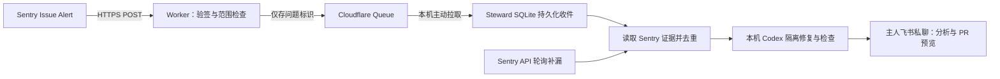

# 无服务器、无自有域名的告警接入方案

状态：待实现和部署的方案。2026-11-09 核对官方资料。现有本地轮询、Webhook 接收器和 MCP 配置不等于下述云端入口已经存在。

## 建议

先用 **Cloudflare Worker + Queues + 本地拉取消费**做试点。Worker 使用账户提供的固定 `workers.dev` HTTPS 地址，不需要购买服务器或域名；本机主动拉取队列，代码、Codex 登录和飞书应用凭证继续留在本机。Mac 休眠时云端仍能接收，恢复后在消息保留期内补消费。

这能做到云端持续收件，但 Mac 离线时不能执行修复。全天修复需要另行选择常开机器，不能把云端收件等同于云端 Agent。

Cloudflare 官方把 `workers.dev` 定位为个人/非关键业务用途，生产建议自有域名或 route。因此本方案先用于可回退的试点，保留轮询；正式关键告警接入前再接公司批准的子域名，并验证真实 Sentry 请求能穿过平台入口检查。[workers.dev 文档](https://developers.cloudflare.com/workers/configuration/routing/workers-dev/)

## 资源与配置

| 部分 | 拟配置 | 责任 |
| --- | --- | --- |
| Worker | `steward-alert-ingress` | 验证原始请求体 HMAC、安装 UUID、项目、环境；拒绝错误签名和超大正文 |
| 公网地址 | `https://steward-alert-ingress.<account-subdomain>.workers.dev/sentry/<source-id>` | 上线后以实际返回地址为准；这里只是模板 |
| 队列 | 每个 Steward 实例独立一条队列 | 隔离不同飞书组织/主人，不让实例争抢同一条消息 |
| 本机消费者 | 同一 Steward 进程中的可选组件 | 一次只消费有限批次；复用既有队列、预算和单代码执行限制 |
| 项目映射 | 每个 source 独立的 organization/project/environment/chat/project-grant | 后续新项目新增配置，不复制业务代码 |
| 云端 Secret | Sentry Internal Integration Client Secret | 只用于验签；不上传 Sentry 读取 Token、飞书凭证或 Codex 登录 |
| 本地凭证 | Cloudflare 队列读取/确认权限的 Token | 仅供指定账户和配置中的队列调用；不注入代码执行子进程 |

HTTP pull consumer 支持从 Cloudflare 外部拉取并确认消息。官方要求 Queues Read/Write 权限；部署时按平台实际支持的资源粒度收窄，不声称该 Token 天然只能操作单个队列。[Pull consumers](https://developers.cloudflare.com/queues/configuration/pull-consumers/)

## 数据与可靠性约定

1. Worker 对原始 body 验签，仅接受配置中安装、项目和环境的 `event_alert/triggered`。来源由 URL 和云端 allowlist 确定，不能由正文指定代码仓库或通知人。
2. 验证完成后，仅写入版本、source ID、组织、项目、环境、issue/event ID 与接收时间。正文、用户资料、请求、Cookie、堆栈和源码不进入云队列或日志；详细证据在本地向 Sentry 查询。
3. **只有队列写入成功才向 Sentry 返回成功**；写入失败返回可重试状态。不等待模型执行。以真实 Sentry 超时/重试行为做验收，不仅测试自制 POST。
4. 本地拉取后，校验消息格式和本机授权，事务写入本地持久化收件，再 ACK 云队列。不能在本地持久化前 ACK，也不能等整个修复完成才 ACK。
5. 至少一次投递可能重复；来源授权键 + issue ID 的唯一约束与轮询共用。崩溃发生在本地提交和云端 ACK 之间时，重投只产生一次任务。
6. 本机容量不足时限制拉取；本地收件已保存的消息可以 ACK，等待配额时不丢失。API 故障进入已有重试流程。停用来源或改授权时不自动继承旧权限。
7. 启动后检查最老待处理消息年龄、拉取失败次数、队列积压和本机待处理名额。超过消息保留期的离线期间不能保证逐条恢复；轮询补漏也不是完整的 Alert Rule 事件重放。
8. 不开放 Mac 入站端口，不公开本地控制台或 Codex App Server。飞书私聊和 PR 仍走既有 outbox、检查和发布确认。

## 与现有实现的差距

已实现的 `src/alert-webhook.ts` 是 Node 本地 HTTP 接收器，不能原样部署到 Worker。需要抽取验签/范围校验逻辑，增加 Worker 的 Web Crypto 适配和 Queues producer，再增加本地 pull consumer 接到现有持久化收件。当前没有这些云端资源、队列消费者或部署脚本。

复用的部分包括 `AlertPoller` 的 evidence/intake、`alert_tasks` 去重与额度、Engine 调度、隔离工作区、私聊通知和 PR 预览。不引入第二个模型编排器，不让云端直接执行 Git。

实现时至少覆盖：坏签名/错误来源、云入队失败不 ACK、重复投递、进程崩溃后重投、授权撤销、配额满、队列过期、网络断开、与轮询同时收到同一 issue。

## 费用与离线窗口

| 阶段 | 方案 | 已核对的限制 |
| --- | --- | --- |
| 小规模试点 | Workers Free + Queues Free | Worker 每日 100,000 请求；Queues 每日 10,000 标准操作；消息只保留 24 小时 |
| 持续使用 | 评估 Workers Paid | 起价 $5/月，超额另计；Queues 默认保留 4 天，可配置最长 14 天 |

一次小消息通常包含写入、读取、删除三种操作；重试会增加操作，不能把“每日 5 个修复任务”当作“每日只有 5 次接收”。例如每天 100 条告警，在无重试、每条不超过 64 KB 的假设下，消息写读删约 300 操作/天；实际还要检查请求、轮询和平台计费情况。费用与保留期以创建资源时页面为准；此方案不授权自动开通付费套餐。

依据：[Workers 价格](https://developers.cloudflare.com/workers/platform/pricing/)、[Queues 价格](https://developers.cloudflare.com/queues/platform/pricing/)。免费队列 24 小时不适合把周末关机后完整补收作为保证。

## 实施顺序与验收

1. 完成本地消费者、云端接收器、配置模板与模拟测试，整理可审查 PR。
2. 明确使用的 Cloudflare 账户，准备免费试点资源和最小权限配置；不迁移公司已有域名或其他应用。
3. 完成新云端权限、凭证和 Sentry Internal Integration 的实际授权，再部署入口并回读实际 URL、队列配置和保留期。
4. 创建只针对目标项目 production 的 Issue Alert Rule，投递一次真实告警；核对验签、云收件、本地收件、只创建一个任务和主人私聊回执。
5. 停止本地消费者后投递，再恢复验证补收；模拟重复、超时与拒绝签名。云端发布成功不能代替这一验收。
6. 保留原来的五分钟 Sentry 轮询，确认重复来源不会重复建单；出现问题时停用云端 Rule/消费者即可回退，保留本地已有任务。

正式上线前单独决定是否接公司域名、扩大离线窗口或迁移到常开机器。当前交付仅为方案，没有创建账户、购买域名、开通付费套餐或暴露本机服务。
